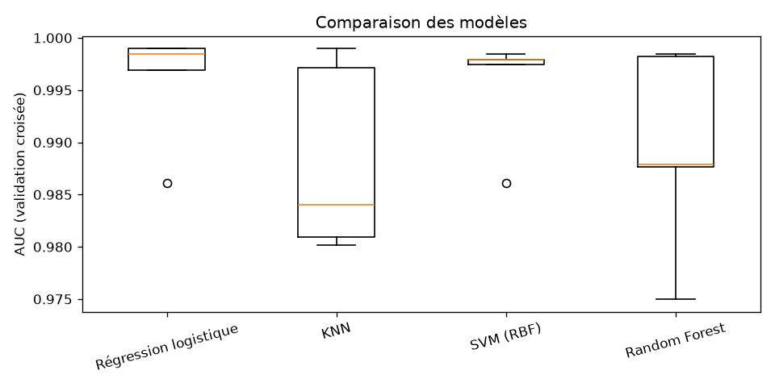
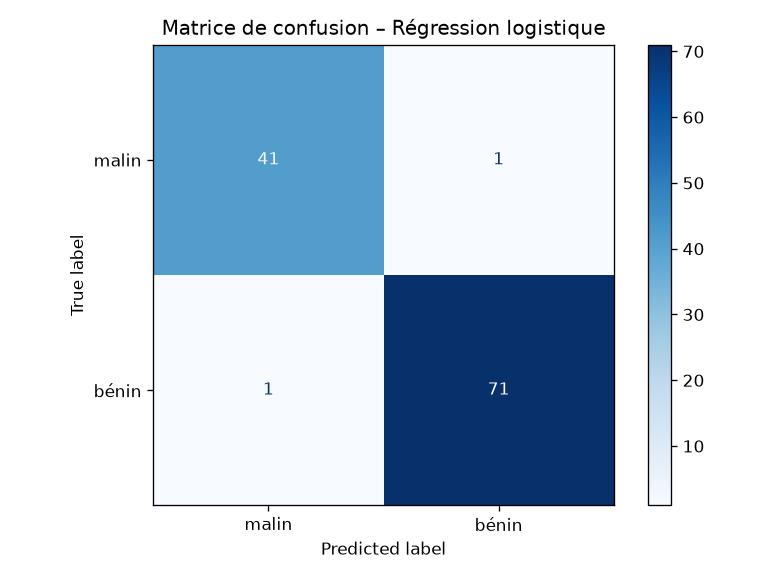
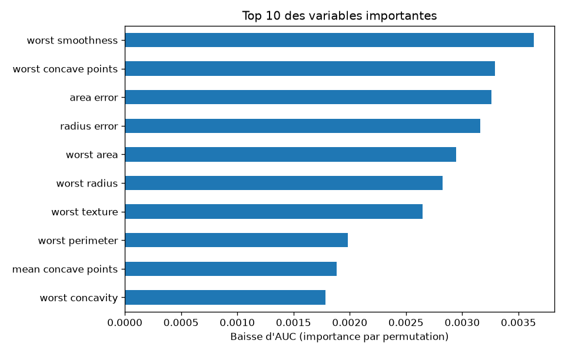

# Classification du cancer du sein (tumeur bénigne / maligne)

Mini projet de Data Science de bout en bout avec scikit-learn : exploration des données, comparaison de modèles par validation croisée, évaluation sur un jeu de test et interprétation (importance des variables).

## Données
Dataset *Breast Cancer Wisconsin (Diagnostic)* fourni par `scikit-learn` : 569 échantillons, 30 variables numériques, aucune valeur manquante. Aucun téléchargement nécessaire.

## Méthodologie
1. **EDA** : répartition des classes (357 bénins / 212 malins), corrélations.
2. **Séparation** train/test 80/20, stratifiée (`random_state=42`).
3. **Comparaison** de 4 modèles (régression logistique, KNN, SVM RBF, Random Forest) : validation croisée stratifiée à 5 plis, métrique AUC. Les modèles sensibles à l'échelle utilisent un `StandardScaler` dans un `Pipeline` (pas de fuite de données).
4. **Évaluation** du meilleur modèle sur le test : rapport de classification, matrice de confusion, AUC.
5. **Interprétation** : importance par permutation.

## Résultats
| Modèle | AUC (CV 5 plis) |
|---|---|
| Régression logistique | 0.996 ± 0.005 |
| SVM (RBF) | 0.996 ± 0.005 |
| Random Forest | 0.989 ± 0.009 |
| KNN | 0.988 ± 0.008 |

Meilleur modèle (régression logistique) sur le test : **accuracy 0.98, AUC 0.995**.





## Lancer le projet
```bash
python -m venv .venv && source .venv/bin/activate   # Windows : .venv\Scripts\activate
pip install -r requirements.txt
python main.py
```
Les figures sont générées dans `reports/figures/`.

## Pistes d'amélioration
- Optimisation des hyperparamètres (`GridSearchCV`)
- Ajustement du seuil de décision (privilégier le rappel sur la classe « malin »)
- Réduction de dimension (PCA) et analyse de la multicolinéarité

## Limites
Projet pédagogique : ne pas utiliser pour un usage médical réel.
